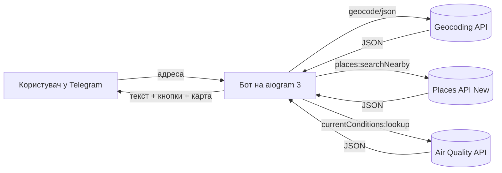

# 🏘 Neighborhood Analyzer

Telegram-бот для аналізу району: надсилаєте адресу — бот показує місто, район і точку на карті, а кнопками — найближчі магазини, ресторани, розваги, спорт, парки, транспорт і якість повітря. Дані беруться з **Google Maps Platform**: Geocoding API, Places API (New) та Air Quality API.

> PoC-проєкт з інтеграції хмарного API. Автор: **Наливайко Катерина**, група МІ-41.

<!-- Після запуску бота покладіть скріншоти в docs/screenshots/ і приберіть коментар:
<p>
  
  
</p>
-->

## Можливості

- 📍 Адреса → **місто, район, повна адреса** і точка на карті (Geocoding API).
- 🛒 Магазини, 🍽 Ресторани, 🎡 Розваги, 🏃 Спорт, 🌳 Парки — **топ-10 місць** у радіусі 1 км з відстанню, рейтингом і посиланням на Google Maps; сортування **за відстанню** або **за рейтингом** (Places API (New) — Nearby Search).
- 🚌 Транспорт — автостанції, станції метро, залізничні станції та зупинки громадського транспорту поблизу.
- 🌿 Екологія — індекс якості повітря (UAQI), концентрації NO2, PM10, PM2.5 тощо й рекомендація для здоров'я (Air Quality API).
- ⬅️ Назад — повернення до меню адреси або введення нової адреси.

## Як це працює



## Використані API

| API | Запит | Навіщо | Безкоштовно / міс |
|---|---|---|---|
| Geocoding API | `GET maps.googleapis.com/maps/api/geocode/json` | адреса → координати, місто, район | 10 000 |
| Places API (New) | `POST places.googleapis.com/v1/places:searchNearby` | місця в радіусі (з рейтингом — SKU Enterprise) | 5 000 / 1 000 |
| Air Quality API | `POST airquality.googleapis.com/v1/currentConditions:lookup` | якість повітря | 10 000 |

Актуальні ціни: <https://developers.google.com/maps/billing-and-pricing/pricing>. Відповіді кешуються на 1 годину, тож повторні натискання не витрачають квоту.

## Швидкий старт

Потрібно: Python 3.10+, акаунт Google Cloud з підключеним білінгом, Telegram.

### 1. Google Cloud

1. [console.cloud.google.com](https://console.cloud.google.com/) → створіть проєкт.
2. **Billing** → підключіть платіжний акаунт.
3. **APIs & Services → Library** → увімкніть **Geocoding API**, **Places API (New)** і **Air Quality API**.
4. **APIs & Services → Credentials → Create credentials → API key**.
5. У ключі: **API restrictions → Restrict key** → виберіть ці три API → Save.

### 2. Telegram

[@BotFather](https://t.me/BotFather) → `/newbot` → назва → username на `bot` → скопіюйте токен.

### 3. Запуск (macOS / Linux)

```bash
cd neighborhood-analyzer
python3 -m venv .venv
source .venv/bin/activate
pip install -r requirements.txt
cp .env.example .env      # впишіть TELEGRAM_BOT_TOKEN і GOOGLE_MAPS_API_KEY
python -m bot
```

Windows: `python` замість `python3`, `.venv\Scripts\activate`, `copy` замість `cp`.

### 4. Перевірка ключа без Telegram

```bash
python -m bot.check_api "Хрещатик 22, Київ"
```

Скрипт по черзі звертається до всіх трьох API і показує, який з них працює.

## Тести

```bash
pip install -r requirements-dev.txt
pytest
```

Тести не звертаються до мережі: відповіді Google і Telegram підміняються заглушками.

## Структура проєкту

```
bot/
  __main__.py       точка входу (python -m bot)
  config.py         читання .env
  google_client.py  клієнт Geocoding, Places (New), Air Quality API
  analyzer.py       відстані (haversine), сортування, транспорт
  categories.py     кнопки-категорії й типи місць
  formatting.py     тексти повідомлень
  keyboards.py      інлайн-кнопки
  handlers.py       обробники Telegram
  cache.py          кеш з TTL
  check_api.py      перевірка ключа з терміналу
tests/              pytest
```

## Безпека

- Ключі лише у файлі `.env`, який є в `.gitignore` і не потрапляє на GitHub.
- API-ключ обмежений трьома потрібними API.

## Ліцензія

MIT
